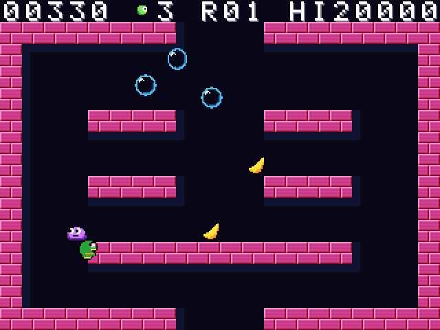
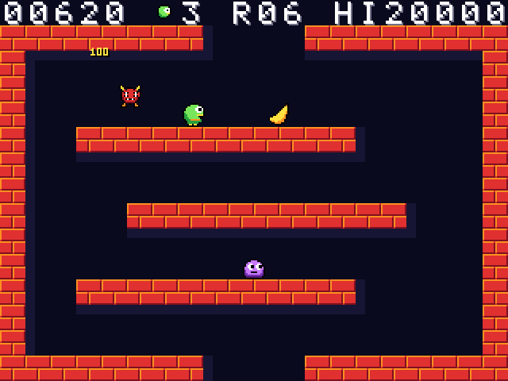
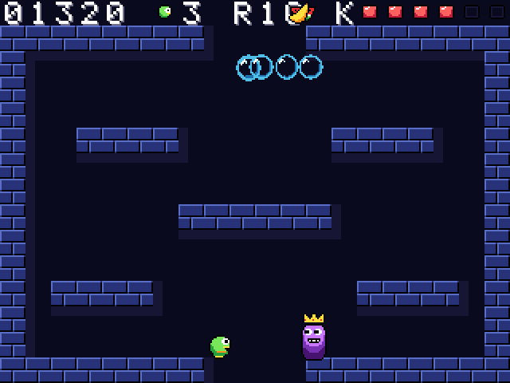

# Bubble Keep

Trap monsters in bubbles, pop them in chains, collect fruit and power-ups, and defeat the Slime King. A single-screen platformer with 30 rounds and a rising flood that keeps you moving.

For the Zeal 8-bit computer with the Video Board, running Zeal 8-bit OS.

  

## Controls

Menu prompts default to a connected SNES pad and follow the last device used
in the menu. The selected keyboard/pad display stays fixed during the game.

| Action | Keyboard | SNES pad |
|---|---|---|
| Move | Left / Right | D-pad |
| Jump (hold for height) | Z or Space | B |
| Blow bubble | X or A | A or Y |
| Start / pause | Enter | Start |
| Quit (title screen) | Right Shift | Select |

Hold jump while falling onto a bubble to bounce off it instead of popping it.

## How to play

- Trap enemies, then touch their bubbles to pop them. Nearby bubbles chain together.
- Collect fruit for points and power-ups. Every tenth round ends with the Slime King.
- Clear the room before the flood rises. Hold jump to bounce on bubbles.

## Build

Install the Zeal Development Environment (ZDE) and its SDK dependencies, then run
these commands from this repository:

```sh
zde deps install zgdk
zde deps install zar
zde cmake
```

The build produces `bin/bubblekeep.bin` and `bin/bubblekeep.zar`.
Use a current ZGDK installation.

## Run

For Zeal-NativeEmulator, mount the output folder as HostFS:

```sh
zeal-native -r /path/to/os_with_romdisk.img -H bin
```

At the ZOS prompt:

```text
cd H:/
exec bubblekeep.bin
```

On hardware, copy the `.bin` and `.zar` together and run the game from that folder.

Build variants, asset editing and optional development tools are documented in
[the development guide](docs/development.md).

## License

Copyright 2026 David Higgins. Game code and original assets are licensed under
[Apache License 2.0](LICENSE). External SDKs and tools retain their own licenses.
